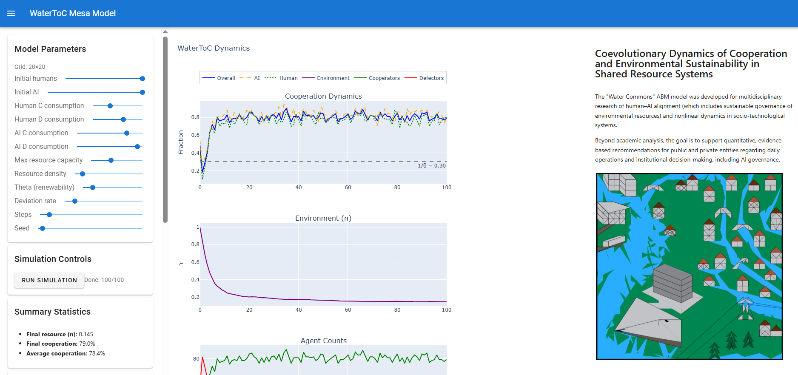

# WaterToC
### ABM simulating a coupled coevolution between game-theoretic strategies and the environment to explore dynamics of human-AI cooperation around a shared commons resource - water.
Published study: [Emergent Spatial Traps in the Coevolutionary Commons: Human-AI Cooperation Under Environmental Feedback](https://doi.org/10.1007/978-3-032-29909-3_8), ICCS 2026, Springer LNCS.

## Model and analysis

The [model and analysis reference](model-and-analysis.md) describes the replenishment equations, statistical estimators, regression cases, and execution commands. Source checksums and the dependency environment are recorded in `reproducibility/`.

The default replenishment rule is `repository`. The `pre_floor_change` and `manuscript` variants support comparisons of feedback expressions and clipping limits. The sensitivity notebook computes results from the selected configuration and random seeds.

This is a stylized resource model. Human and AI agents share the same binary decision rule and differ in consumption; they do not simulate human cognition or deployed AI systems. The reference replicator ODE is a separate model, not a derived limit of the implemented ABM.
We created an interactive agent-based model simulating consumption of a shared, renewable resource using a game-theoretic framework with environmental feedback. Although its original use was to simulate a ToC scenario with water as the shared resource, it can be applicable for a variety of scenarios including simulating climate disasters, environmental sensitivity to resource consumption, or influence of environmental degradation to agent behaviour.
The primary goal of the model is to explore the socio-environmental feedback loops that lead to complex system dynamics like limit cycles or fixed-point stability. It was inspired by the Demographic Prisoner’s Dilemma on a Grid (https://mesa.readthedocs.io/stable/examples/advanced/pd_grid.html#demographic-prisoner-s-dilemma-on-a-grid). The main innovation of this model is the added environmental feedback interpolating the expected payoffs (as introduced by the oscillating ToC dynamical system studied by Weitz et al 2016), but in a stochastic heterogeneous agent-based setting with with local resource consumption and replenishment.

The model is built using Mesa 1.2.1 for the model and Solara for the interactive web-based dashboard.
Mesa 1.2.1 is pinned for compatibility with the scheduler and grid APIs. Regression tests and analysis benchmarks are included in `tests/`.

## Features

* **Interactive Dashboard:** Adjust parameters, inspect trajectories and heuristic recurrence diagnostics, and view the final spatial state. Recurrence and low variance do not establish limit cycles or fixed-point attractors.
* **Complex Agent Behavior:** Agents' strategies are determined by a game-theoretic model influenced by current environmental states.
* **Advanced Analysis:** Besides the Solara interface, the project includes scripts for generating various visualizations, including heatmaps, 3D plots, and limit cycle diagrams from simulation data.


## Key Model Parameters

The model accepts the following key parameters. The dashboard exposes its original sliders; select feedback variants through the model API or sweep CLI.

| Parameter | Description |
| :--- | :--- |
| **`theta` (${\theta}$)** | The sensitivity of the environment to cooperation. Higher values mean cooperation has a stronger positive effect on resource replenishment. |
| **`deviation_rate`** | The probability (0.0 to 1.0) of choosing the opposite of the payoff-based best response. |
| **`initial_humans` / `initial_ai`** | The starting number of each agent type. |
| **`*_C_allocation`** | The amount of resource an agent consumes when it **C**ooperates. |
| **`*_D_allocation`** | The amount of resource an agent consumes when it **D**efects. |
| **`max_water_capacity`** | The maximum amount of resource any single water cell can hold. |
| **`water_cell_density`** | The probability that a grid cell contains the resource. |
| **`feedback_rule`** | Explicit replenishment variant: `repository`, `pre_floor_change`, or `manuscript`. |

## Installation

1.  **Clone the repository:**
    ```bash
    git clone https://github.com/luka-waronig/human-ai-commons.git
    cd human-ai-commons/iccs2026
    ```

2.  **Create and activate a virtual environment:**
    ```bash
    python3.12 -m venv .venv
    source .venv/bin/activate  # On Windows: .venv\Scripts\activate
    ```

3.  **Install the required libraries:**
    ```bash
    python -m pip install --require-hashes -r requirements.txt
    ```


## Usage

### Interactive Dashboard

To launch the main interactive dashboard with the model, run the following command from the `iccs2026/` directory:

```bash
solara run server.py
```
The application will then be available in your browser at `http://localhost:8765`.

### Analysis Scripts

The `plotting/` directory contains scripts for offline analysis and visualization of data generated from model runs.

Run the following from the `iccs2026/` directory in the activated environment:

```bash
python -m pytest -q
python sweep_run.py --theta 2 5 --capacity 20 --density 0.3 --runs 3 --steps 100 --output results/example/sweep.csv
python -m plotting.fpoint --input results/example/sweep.csv --output-dir results/example/analysis
python -m plotting.peak_envelope_oscillations --input results/example/sweep.csv --output-dir results/example/analysis
python -m plotting.morlet_wavelet --input results/example/sweep.csv --output-dir results/example/wavelets
python -m water_toc.audit --replications 12 --steps 100
python -m water_toc.spatial_null --seed 42 --permutations 499
```

Generated CSVs carry a feedback identifier, and manifests record configurations, source hashes, and dependency versions. `--design manuscript-table2` selects the density list in Table 2; the default selects the repository sweep design.


## File Descriptions

* `server.py`: The main Solara application. This script creates the interactive dashboard, including all UI components and plots.
* `water_toc/model.py`: Defines the core `WaterToC` Mesa model, which manages the grid, agent scheduling, and environmental state.
* `water_toc/agents.py`: Defines the `Human` and `AI` agent classes and their decision-making logic.

### Plotting & Analysis

* `plotting/`: A directory containing all scripts for data analysis and visualization.
    * `3Dplots_coop.py` / `3Dplots_env.py`: Scripts to generate 3D surface plots for cooperation and environment state gotten from parameter sweep data.
    * `fpoint.py`: Descriptive low-variance tail analysis, retaining per-run diagnostics and undefined ADF results.
    * `morlet_wavelet.py`: Centered squared Morlet coefficients computed per realization, with edge exclusion and restricted resolvable periods.
    * `peak_envelope_oscillations.py`: Per-run offset-aware oscillation fits; positive fitted decay means damping and negative decay means growth.
* `sweep_run.py`: Parameter sweeps with stable run identifiers and provenance manifests.
* `spatial_analysis_sweep.py`: Spatial summaries written under `sweep_outputs/`.
* `spatial_analysis_plotting.py`: Plot the spatial summaries after running the spatial sweep.


Interactive dashboard:

